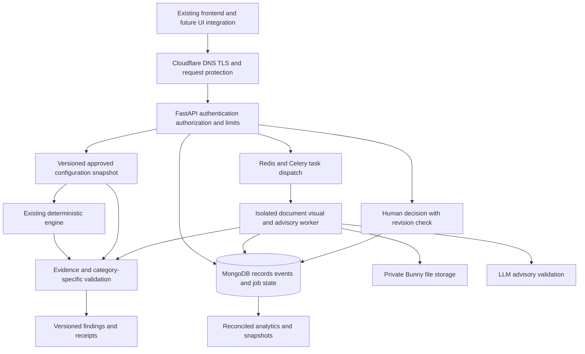

# Pramana / BrandSentinel: backend implementation plan

Prepared 2 November 2026. Research and planning only. BrandSentinel is treated as the product referred to in this conversation; the inspected repository and submitted report use Pramana. No rename is proposed here.

## 1. Decision and timing

Keep FastAPI, the deterministic engine, versioned evidence, finding validation, and human approval. Add durable NoSQL storage, authenticated ownership, safe background processing, bounded document/visual checks, and measured delivery infrastructure. The three Round 3 commitments remain mandatory. LLM advice and competitor comparison are additional work with separate release gates.

The user confirmed the deadline: **3 November 2026, 23:59 IST**. Coding begins tomorrow evening. The full proposed v1 cannot responsibly be promised as implemented, integrated, deployed, and tested in that remaining evening. The original roadmap alone estimates 17–27 engineer-days across the three broad improvements. That estimate is historical and imprecise, but it demonstrates the scope mismatch. A narrower supported path within each commitment is the deadline candidate; incomplete commitments must be disclosed, not silently redefined as complete.

The chat “Round 3 Improvements Clarified” contains the round-specific organiser message: one team-leader submission, three named improvements, working project, source repository, final PDF, feature list, architecture summary, changes since Round 2, testing, and roadmap. This conflicts with the public website's per-participant wording. Follow the current round-specific form/instructions and resolve conflicting directions before filing; this plan does not establish submission or qualification status.

## 2. Evidence reviewed and current weaknesses

Reviewed the full five-page Round 2 report, published workflow SVG, implementation notes, roadmap, test matrix, API, rule engine, validator, document intake, and repository implementation. Retrieved the earlier chat “Clarify Pramana hackathon advice,” including the explicit NoSQL preference and recommendations for Cloudflare, Bunny, Jenkins, SonarQube, Nexus, code review, and a domain.

The public submission baseline is `ananyap-20/Pramana`, main at `980a09c`, dated 29 October. Local master is `52a5869`, with a different origin and older behavior. Reconcile these without losing local changes or rewriting history before implementation. The existing deleted local documents and untracked Round 2 PDF require deliberate handling.

| Area | Observed condition | Backend upgrade and acceptance evidence |
|---|---|---|
| Identity | No authentication or authorization; a known run ID permits decisions | Verified identity, server-derived organization membership, creator/reviewer/admin permissions, cross-organization denial tests |
| History | Latest 100 summaries in process memory | Durable records and append-only decision events; restart and recovery tests |
| Evidence retention | Exact draft returned to browser, not stored in history | Explicit retention policy; protected immutable draft snapshots for resumable reviews, or honest metadata-only history with no promise of later replay |
| Concurrency | Process-local lock; different processes have different state | Shared database, conditional updates, duplicate-request protection, concurrent decision tests |
| Rule execution | Four hardcoded patterns; first active rule per category | Versioned typed rule parameters, compiled configuration snapshots, multiple rules per category, bounded patterns; retain all existing behavior |
| Finding validation | Exact explanation/action equality with seeded rule; status copied from candidate | Category-specific semantic checks, derived permitted statuses, separate advisory validation for LLM output |
| Files | Bounded DOCX paragraphs; parsing happens during request | Retain safe limits; add PDF/image pipeline in isolated workers with resource caps |
| Visual checks | Absent | Controlled HTML/assets, measurable logo/palette/contrast/alt-text findings |
| Analytics | Absent; counts in volatile summaries | Reconciled aggregates from persisted events, declared windows and denominators |
| Operations | No verified production recovery, access isolation, or measured latency | Repeatable container release, monitoring, backup restore, readiness and deployment smoke tests |
| Documentation | Local README is stale; public README says Render blocked, later PDF says Vercel reachable | Identify the actual deployment and its commit; replace inconsistent claims with dated verification |

The workflow SVG's “Authorised reviewer” is a conceptual role, not an implemented permission control. Its config arrow does not adequately show the validator independently reading approved sources. The proposed diagram must include that dependency, identity, storage, job states, error paths, and the distinction between advice and verified findings.

The report's 54 passing tests and successful local journey are recorded evidence from 29 October. They are not fresh test results for the next release. Earlier checks in this chat found the old local frontend failing TS1294 and system-Python tests blocked by a missing dependency; neither result is a test of the newer published baseline. No new implementation tests were run for this planning document.

## 3. Proposed architecture and service choices

This is one backend codebase deployed as API and worker processes, not a microservice rewrite. All additions sit behind existing repository/service boundaries. Existing endpoints remain compatible while new APIs receive explicit schemas.

| Choice | Recommendation and reason |
|---|---|
| FastAPI | Keep. No evidence supports a language/framework rewrite. Keep CPU-heavy work outside the API event loop. |
| MongoDB | Authoritative NoSQL record store, respecting the prior decision. Use one PyMongo client/pool per process, bounded pool waits, indexed queries, and deployment near the API. No claim that NoSQL is inherently faster than SQL. |
| Cloudflare | DNS/TLS and protection for API traffic; cache only explicitly eligible public/versioned responses. It cannot cache away private authorization or durable writes. |
| Cloudflare KV | Optional immutable public configuration cache. Never authoritative for approval, membership, active-version revocation, job state, or audit. Cold reads and stale updates matter; using REST from FastAPI adds a network hop. Start with local bounded config caches before adding KV. |
| Bunny Storage | Private PDF/image/original-file storage; authorized expiring downloads where appropriate. Storage credentials stay server-side. CDN token authentication is a download mechanism, not proof of safe per-user upload credentials. Validate the actual storage upload API before choosing direct upload. |
| Cloudflare R2 alternative | Use instead of Bunny for private uploads if direct presigned upload materially simplifies the path. R2 supports scoped expiring PUT URLs. Do not maintain duplicate object stores without a measured need. Keeping Bunny is the default proposed choice, subject to an access/latency proof. |
| Celery + Redis | A justified addition for OCR/rendering/LLM jobs. Redis dispatches work; MongoDB owns durable job status and results. Bound concurrency and retry counts. This increases deployment work and is not a free deadline shortcut. |
| Hosting | Keep the frontend deployment for this pass. Use a container-capable backend host with an always-running API/worker near MongoDB. A sleeping service is incompatible with consistently low latency. Select and budget the host after checking existing access; no free-tier guarantee. |
| Identity | For a controlled v1, Cloudflare Access can provide login, with backend JWT signature/issuer/audience/expiry validation and application-level organization/role checks. Judge access must be tested. A public self-service SaaS needs a deliberate identity/onboarding design beyond simply enabling Access. |

Avoid serially proxying private assets through both CDNs. Distinct API and asset hostnames can give each provider one responsibility. A GoDaddy domain is optional branding and DNS ownership work; it provides no evidence of backend speed or quality.

## 4. Performance contract

“Every action completes in milliseconds” is not achievable for arbitrary uploads, OCR, remote LLM calls, and remote clients. **Ordinary reads/writes should complete within a few hundred milliseconds under a declared load; expensive work should acknowledge quickly and complete asynchronously.** Acceptance and completion are separate metrics.

Initial targets below are proposed budgets, not measured claims. Measure API service time and client-observed elapsed time separately, with the client region, connection conditions, input size, concurrency, and cold/warm state recorded.

| Operation | Proposed warm API p95 budget | Boundaries |
|---|---:|---|
| Versioned config, one page of history, job status | 150 ms | At most 50 history records per page; no LLM call |
| Human decision, including acknowledged durable write | 250 ms | Correctness and durability cannot be weakened to meet this target |
| Deterministic analysis | 300 ms | Up to 10,000 characters and the bounded initial rule set |
| Create expensive-work job | 250 ms | After upload bytes are received and job is durably registered; excludes file transfer |
| Analytics snapshot or existing comparison | 200 ms | Fixed response size; expose last-updated time |

Start acceptance measurements at 10 concurrent users. Treat higher load as a separate stress test. For LLM/OCR/rendering, report actual completion percentiles; initial operational limits can be 20 seconds for one LLM attempt and 60 seconds per bounded document job. These are timeout policies, not performance promises.

Optimizations in order:

1. Place API, database, queue, and worker close together; reuse database and HTTP connections. Remove avoidable network calls before micro-optimizing Python.
2. Build dictionary lookups and compiled matchers once per immutable configuration version. Reuse them across runs. For four rules, a simple scan is appropriate; only consider multi-pattern matching when profiling shows rule-count cost.
3. Keep original draft text immutable. Normalization used for matching must preserve a mapping back to original character spans, including Unicode edge cases.
4. Use indexes on organization, brand, creation time, run ID, and event sequence as query patterns require. Cursor pagination and projections avoid sorting/transferring all history.
5. Separate CPU-bound parsing from network-bound API requests. Limit worker concurrency, page count, decoded pixels, response size, and queued work per organization.
6. Reuse extraction only within the same authorized organization and retention policy. A key includes file digest, parser version, language, and extraction options. Never reuse cross-tenant private outputs.
7. Cache approved immutable rule/source versions locally. Check current authorization and active-version selection authoritatively. Missing/stale cache entries must safely fall back; correctness must not depend on TTL luck.
8. Do not cache decisions or private drafts at public edges. LLM advice reuse requires exact input/evidence/model/prompt versions and explicit retention consent.
9. Start analytics with indexed bounded queries; introduce materialized aggregates only when measured. Publish aggregate freshness and rebuild them from events.

Tests must include cache misses, invalidation/revocation, cold starts, denied access, and queue saturation. Report p50/p95/p99, errors, throughput, memory, and slow-operation traces. Average latency alone hides failures.

## 5. Mandatory improvement 1: richer document and image intake

Smallest useful supported scope: text PDFs plus PNG/JPEG OCR and existing DOCX paragraphs. Scanned PDFs use the same raster/OCR path with explicit page caps. English-first is an honest initial language boundary.

- Candidate tools: pypdfium2 for PDF text/geometry and rendering, Tesseract for OCR. Pin versions, confirm platform packages and license notices, and benchmark on our corpus before final selection.
- Extract text directly when usable; OCR only pages/regions needing it. Keep page number, region bounds, file digest, extraction method/version, and text span mapping.
- Expose extraction status: queued, processing, needs confirmation, ready, failed, or expired. A low-confidence result is not a verified original quote. Confidence is a parser signal, not a calibrated probability of correctness.
- Confirmation creates a new immutable extracted-text version with actor and time. Editing text invalidates the old analysis; a human correction must not be misrepresented as verbatim text from the original file.
- Keep input allowlists, magic/type checks, byte/page/pixel/expanded-size limits, process timeouts, temporary-file cleanup, and safe extraction errors. Reject unsupported/encrypted/malformed documents clearly. No macros, scripts, embedded instructions, or network fetches from documents.
- Run parsers in a resource-limited process/container with restricted filesystem/network access. Record failures without logging confidential contents.

Acceptance: at least 95% of expected paragraphs recovered on a separately labeled supported text-PDF set, with ordering and omission checks; low-confidence OCR always marked and held for confirmation. Test difficult layouts and state unsupported cases. Do not score normalization-only matches as proof that quoted original text exists.

## 6. Mandatory improvement 2: visual brand and accessibility checks

Backend-only scope: analyze bounded supplied HTML/CSS and referenced approved uploaded assets in an isolated renderer. No arbitrary website browsing in the initial path. Produce stable JSON that the teammate can integrate later.

- Logo: exact asset digest against an approved manifest; clearly limit this to exact assets. Approximate logo detection in flattened images is a separate, unproven capability.
- Palette: inspect configured CSS roles/elements and permitted colors. Do not flag every pixel of a photograph as an unauthorized brand color.
- Contrast: record foreground, background, font size/weight, computed ratio, rule/version, and element/region. Use WCAG 2.2 AA thresholds where applicable: 4.5:1 normal text, 3:1 qualifying large text. Account for exemptions and uncertainty; gradients, image backgrounds, or unresolved compositing should produce an indeterminate result instead of a false pass.
- Alt text: detect missing descriptions on meaningful HTML images and handle intentionally decorative images. Presence of text does not prove descriptive quality. Alt-text checks do not apply to a standalone PNG as if it were HTML.
- Typography: optional exact configured family/size checks only after the promised logo/color/accessibility path passes.

Rendered HTML processing is a backend feature even though it examines visual output. Disable scripts and outbound requests in the supported input path; isolate the browser, cap DOM/asset sizes and render time. Do not claim complete WCAG compliance or general visual brand recognition.

Acceptance: a labeled supported fixture suite, reproducible measurements for every finding, no unexplained misses, and explicit unsupported states. Include near-threshold contrast, transparency, invalid assets, decorative images, malicious HTML, and timeouts.

## 7. Mandatory improvement 3: persistent audit and analytics

Suggested collections: organizations/memberships; immutable brand configurations and source versions; draft versions or metadata-only references according to retention policy; review runs; append-only decision events; asset metadata; jobs; competitor snapshots. Introduce only collections actually used by the release.

- Derive organization membership from authenticated identity. Every read/write includes the permitted organization; user-supplied organization IDs are not authority.
- Preserve run ID, exact evaluated version/digest, engine/configuration versions, actor, decision, timestamps, and request identity. Draft hashes alone do not support later evidence replay: resumable review needs authorized snapshot retention, encryption/access controls, and expiry/deletion rules.
- Use idempotency keys scoped to organization and endpoint. Same key with different payload is a conflict. Repeated submission of the same decision must not create duplicate audit events.
- Use optimistic revision checks to prevent one reviewer silently overwriting another's decision. Corrections append events. Avoid unbounded decision arrays.
- Where updating a summary and inserting an event must be atomic, use a transaction on a supported MongoDB deployment, or make the event authoritative and derive the summary. Do not assume separate writes are atomic.
- Use durable job registration and an outbox/dispatcher when database commit and queue publication must survive crashes. Retried worker execution must not duplicate results. Include bounded retries, cancellation, dead-letter handling, and an explicit terminal error.
- Analytics: counts by finding category, review outcome, period, and repeated rule failures. Define denominator, time zone, excluded/pending runs, and data freshness. Avoid unmeasured business ROI claims.
- Test backup restoration, retention expiry, and deletion behavior. Application-enforced append-only events are not automatically an immutable or cryptographically tamper-proof audit log.

Acceptance: reviews and decisions survive restart/redeploy; unauthorized and cross-organization operations fail; duplicate/concurrent requests preserve event integrity; aggregates reconcile exactly with a known event set; a restore exercise succeeds.

The submitted roadmap mentioned relational PostgreSQL storage. The retrieved chat explicitly chose NoSQL and reported organiser permission for modest stack changes. Record MongoDB as a deliberate implementation change while preserving the promised outcomes: persistence, authorization, audit, and analytics.

## 8. LLM support layer

Purpose: evidence-grounded content insights and formatting proposals, delivered after deterministic results. It cannot approve content, silently replace a draft, or establish facts by generating plausible text.

Pipeline: authorized request -> immutable draft/configuration snapshot -> select a bounded set of approved evidence excerpts -> one bounded model request -> strict schema parsing -> advisory validation -> optional suggestions linked to the same run/version.

Start with lexical retrieval over the small approved evidence set and exact source IDs. A vector database adds little value at this scale; reconsider only if retrieval evaluation shows a real gap. Provider/model choice remains a benchmark decision: select the fastest sufficiently capable model that passes the evidence/advice test set and fits the authorized privacy/cost policy. No provider account or paid use is assumed ready.

Return distinct fields for content insight, quoted draft span, evidence references, rationale, proposed formatting change, and evidence status where a factual assessment is made. Use only the four existing evidence statuses. The server validates draft spans, source IDs/versions, excerpt membership, permissions, and output limits. Citation existence alone does not establish entailment: unsupported factual judgments remain Unsupported or Indeterminate (needs verification). Preserve deterministic results independently.

The existing validator requires explanation and suggested action to equal the configured rule. Retain that protection. Add a separate advisory schema/validator; share provenance checks where useful. If an LLM identifies a possible deterministic violation, re-evaluate the configured rule rather than trusting model text.

Formatting suggestions should be small proposed edits: headings, list structure, paragraph breaks, disclaimer placement. Preserve facts, numbers, product names, and required language; flag proposed factual changes. Applying a suggestion requires an explicit human action and creates a new draft version that is analyzed again.

Prompts and retrieved pages are untrusted data. Give the model no publishing authority or arbitrary tools. Treat structured output as format enforcement, not truth enforcement. Require external-processing consent, minimal necessary evidence, provider retention review, per-organization budgets, limited tokens, timeouts, and a graceful deterministic-only result on failure. Use feature flags; do not make approval depend on LLM availability.

Acceptance: fabricated citations, instruction injection, altered numbers, removed disclaimers, stale versions, unavailable provider, invalid JSON, and cross-tenant retrieval all have tests. Compare advice quality with two human reviewers on held-out examples; measure unsupported assertion rate and useful-suggestion rate separately from rule-engine accuracy.

## 9. Competitor comparison without changing the product direction

Keep this as evidence-backed positioning review for a draft. It should answer: “Which defensible differences can this company communicate, and which claims need proof?” Avoid a generic business-strategy chatbot or an invented company ranking.

Initial scope: one brand, two selected competitors, and a small versioned set of public product/pricing/feature pages reviewed for inclusion. Store source URL, capture time, excerpt, scope, product tier, currency/region if relevant, and expiry. A comparison page is a snapshot, not a live universal truth.

Generate a comparison matrix from matching attributes. Missing data means unknown, not inferiority. Competitor public claims are not approved evidence for our own product. Recommendations should cite both sides, explain the gap, state uncertainty, and propose a concrete content action only when supported.

Example with fictional evidence: if our approved source documents assisted onboarding and neither captured competitor page mentions it, recommend highlighting our documented onboarding service. Do not claim competitors lack onboarding; say it was not found in the reviewed sources.

Refresh sources asynchronously; existing snapshots load quickly. Arbitrary URL intake requires SSRF protection, redirect/IP checks, size/time bounds, and safe parsing; omit it from the first slice. Do not run web research on every user click. Every output includes an as-of date. Unsupported “market leader,” ROI, revenue, or market-share claims are forbidden.

Acceptance: stale/missing/conflicting source data, incomparable plans, currency mismatch, injected page instructions, and unsourced advice. Judge recommendations against a labeled comparison set. This feature ships only after all mandatory commitment gates pass.

## 10. CI, commits, and code discipline

The senior's proposed delivery chain is valid: Jenkins -> tests/security -> SonarQube quality gate -> Docker image -> Nexus -> staging -> approved production release. Its practical cost is operating Jenkins, SonarQube, and Nexus as additional services. None makes request processing faster directly.

For this deadline, recommend GitHub Actions + SonarQube Cloud + GitHub Container Registry as the lighter implementation of the same checks and immutable-image practice, unless Jenkins/Nexus accounts and runners already exist. Record this substitution openly. If the original named tools remain a hard requirement, allocate setup/credentials/maintenance time and do not call a diagram or unexecuted pipeline “implemented CI.”

Pipeline gates: locked install -> formatting/lint/type checks -> backend unit and real-database integration tests -> coverage report -> security/dependency/secret scans -> Sonar analysis -> container build -> staging migration/deploy -> smoke tests -> human production promotion. Scan findings need review; a green scan is not proof of security. Pin CI dependencies and scope credentials. Store test reports, image digest, commit SHA, and environment metadata as artifacts.

Retain a compatibility build check for the existing frontend without changing its implementation. API schemas/examples should be handed off early so the teammate can integrate later without guessing.

Commit practice: one coherent behavior or fix with its relevant tests per commit, typically every 30–60 minutes of productive implementation rather than a forced timer. Push completed milestones frequently; never save the evening as one giant commit. Example sequence: baseline reconciliation; pipeline; persistence contract; identity/authorization; decisions/idempotency; intake; visual checks; analytics; performance/recovery; optional LLM; optional competitor comparison; release evidence/docs. Use `codex/` branches and descriptive messages. Never fabricate dates, squash away provenance just for appearance, commit credentials, or label an unverified milestone complete.

Keep simple functions and explicit data models. Add no unused service adapter, generic plugin framework, speculative abstraction, dead branch, or redundant comment. Comments explain only critical invariants such as source-version checks, atomic updates, offset mapping, or non-obvious security controls. Dependency and module additions must have a used path and a verification case. A PR review agent can flag suspicious diffs on pushes and scheduled scans; humans review suggestions, and it must not continuously rewrite the repository.

## 11. Tests and report-quality evidence

Target meaningful coverage rather than a headline count. A planning envelope is roughly 180–250 distinct automated cases across the existing suite and new boundaries; this is an estimate, not an achievement or a gate by itself. Parameterized cases may cover useful boundaries, but record scenario groups and avoid padding counts with equivalent inputs.

| Suite | Required evidence |
|---|---|
| Existing regression | Preserve all valid existing behaviors and four evidence statuses |
| Evidence integrity | False quote/source/version/status; unsupported semantic conclusion; Unicode spans; revoked rules |
| Identity/persistence | Real database integration, restart, isolation, expired tokens, concurrent writes, idempotency, restore |
| Intake | Labeled text PDFs/scans/images, omission/order, malformed/encrypted/oversized files, low-confidence confirmation |
| Visual | Exact logo/palette fixtures, threshold contrast, exemptions, decorative alt text, uncertainty, isolated rendering |
| Jobs | Crash before/after commit/publication, duplicate delivery, timeout, saturation, cancellation, retry exhaustion |
| Analytics | Independently calculated expected counts; time-window/denominator consistency |
| Advisory/competition | Grounding, injection, unsupported claims, provider failures, stale evidence, fact preservation |
| Performance | Same workload before/after; cold/warm; 1/10/25 concurrent users; mixed read/write/job workload |

Use pytest/coverage for regression/integration and a small repeatable load harness; choose one load tool, not several. A proposed performance run is 10 minutes at the declared supported concurrency after a separately recorded warm-up, followed by a burst and a recovery check. Test actual deployment limits, not only localhost. Do not load-test infrastructure without verifying capacity/cost limits.

Suggested labeled evaluation corpus: 60 text drafts, 30 supported text PDFs, 20 OCR samples, and 30 visual fixtures. Keep a held-out subset untouched during tuning; describe fictional data and limitations. Evaluate paragraph recovery, character error, known finding precision/recall where labels exist, grounding rejection rate, and advice usefulness separately. Increase corpus size only when it adds coverage.

For every report claim retain commit SHA, test name, fixture set/hash, environment, timestamp, command, raw output, failures, and limitations. Automated pass rate is not real-world detection accuracy. Do not call Cloudflare's advertised service latency our app latency. Do not claim performance improved without a measured baseline on a comparable workload.

## 12. Tomorrow's execution and report handoff

The teammate can prepare the report structure, correct stale architecture wording, and add empty evidence tables tomorrow. They should not pre-fill test counts, timings, deployed capabilities, or “production-ready” claims. Testing must run during each feature, not be deferred to final compilation. A final integrated pass still remains necessary.

Implementation order:

1. Reconcile the submitted baseline, reproduce its environment, and establish a passing baseline plus CI. Verify actual deployment/account access and remaining time immediately.
2. Build authenticated durable records and reliable job handling, which support the other features. Keep compatibility with current review APIs.
3. Complete bounded PDF/image extraction and confirmation, with tests.
4. Complete the bounded visual-check API and fixtures.
5. Complete persistent event analytics and restart/isolation/reconciliation tests.
6. Integrate the deployment, measure performance, perform recovery and main-journey checks, and supply report evidence.
7. Add the LLM advisory and competitor slices only when mandatory gates pass and release verification time remains. Both stay in the plan even if honestly deferred from this submission.

At least the final 90–120 minutes should be reserved for integration, deployment checks, evidence capture, PDF assembly, and submission. If coding starts so late that these windows collide, the schedule is infeasible; compressing verification does not make the product shippable. Freeze optional work first. Mandatory commitments stay on the checklist; any undelivered portion must be reported accurately, as the organiser message allows with an explanation.

Backend completion alone cannot prove the deployed product journey is usable. This pass provides API contracts, examples, supported limits, error states, and job/confirmation semantics for the later frontend work. The final integrated UI must actually expose the features to judges before the report calls them shipped.

Release gates: all three commitment acceptance checks pass; original journey works; auth/isolation and retained-data policy verified; fresh tests and measured load evidence available; actual deployed commit identifiable; rollback/restore checked; optional features fail safely; report matches deployment; final form checklist complete. Until then, call it a tested prototype or bounded beta according to the evidence, not a fully shippable v1.

## Sources

- [Published implementation notes](https://github.com/ananyap-20/Pramana/blob/main/docs/optimization-report.md), [workflow diagram](https://github.com/ananyap-20/Pramana/blob/main/docs/pramana_workflow.svg), [Round 3 roadmap](https://github.com/ananyap-20/Pramana/blob/main/docs/round3-roadmap.md), and [test matrix](https://github.com/ananyap-20/Pramana/blob/main/docs/test-matrix.md).
- Local `20ananya.pandey_PRAMANA_CodeStar30.pdf`, all five pages, particularly commitments on page 5.
- Retrieved chats “Clarify Pramana hackathon advice” and “Round 3 Improvements Clarified.” [Round-specific form linked in organiser message](https://forms.gle/FxhT5Z1NupvGTGSw6); its current fields were not inspected. [Public event page](https://wecodecoders.in/events/codestar-30).
- [Cloudflare KV consistency](https://developers.cloudflare.com/kv/concepts/how-kv-works/) and [access overhead FAQ](https://developers.cloudflare.com/kv/reference/faq/).
- [Cloudflare R2 presigned URLs](https://developers.cloudflare.com/r2/api/s3/presigned-urls/) and [Access token validation](https://developers.cloudflare.com/cloudflare-one/access-controls/applications/http-apps/authorization-cookie/application-token/).
- [Bunny CDN token authentication](https://docs.bunny.net/cdn/security/token-authentication/index). Exact Bunny storage upload configuration remains an implementation prerequisite; the old storage-reference URL did not yield usable storage API documentation in this review.
- [PyMongo connection pools](https://www.mongodb.com/docs/languages/python/pymongo-driver/current/connect/connection-options/connection-pools/) and [MongoDB atomicity/transactions](https://www.mongodb.com/docs/manual/core/write-operations-atomicity/).
- [FastAPI background-work guidance](https://fastapi.tiangolo.com/tutorial/background-tasks/) and [Celery task reliability](https://docs.celeryq.dev/en/stable/userguide/tasks.html).
- [pypdfium2 documentation](https://pypdfium2.readthedocs.io/), [Tesseract outputs](https://tesseract-ocr.github.io/tessdoc/Command-Line-Usage.html), and [WCAG contrast](https://www.w3.org/WAI/WCAG22/Understanding/contrast-minimum.html).
- [SonarQube Jenkins integration](https://docs.sonarsource.com/sonarqube-server/10.8/analyzing-source-code/ci-integration/jenkins-integration/key-features) (versioned reference; verify the selected installed version) and [GitHub image publishing](https://docs.github.com/en/actions/tutorials/publish-packages/publish-docker-images).

All performance figures and new-service choices in this document are proposals. No accounts were provisioned, no paid services invoked for application processing, no application code changed, no commits pushed, and no deployment made during this planning pass.
